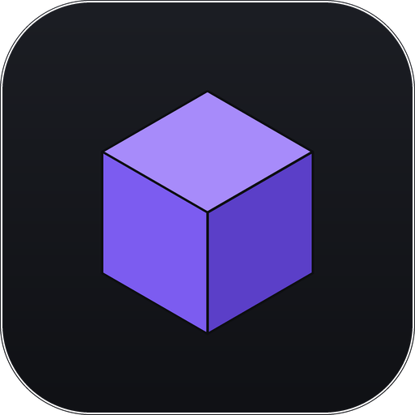
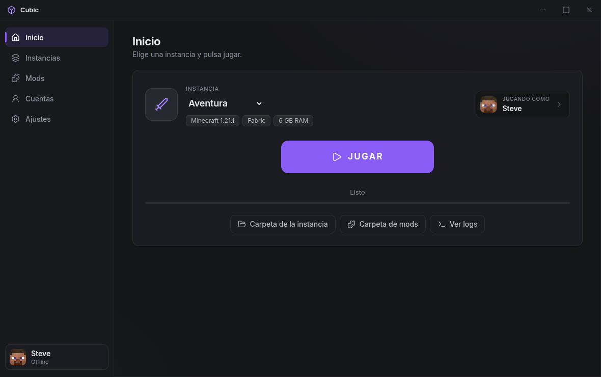
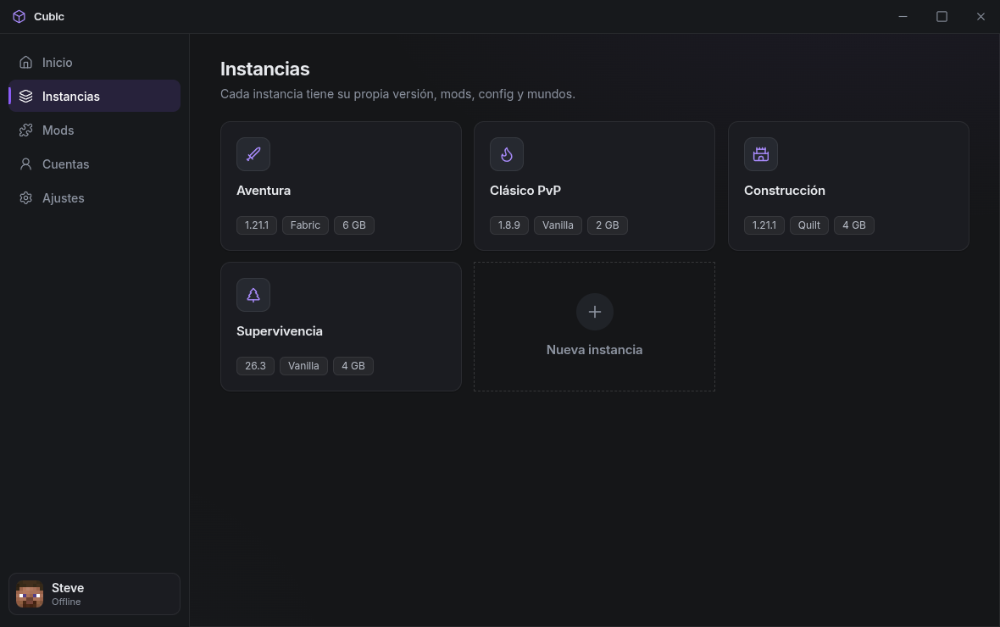
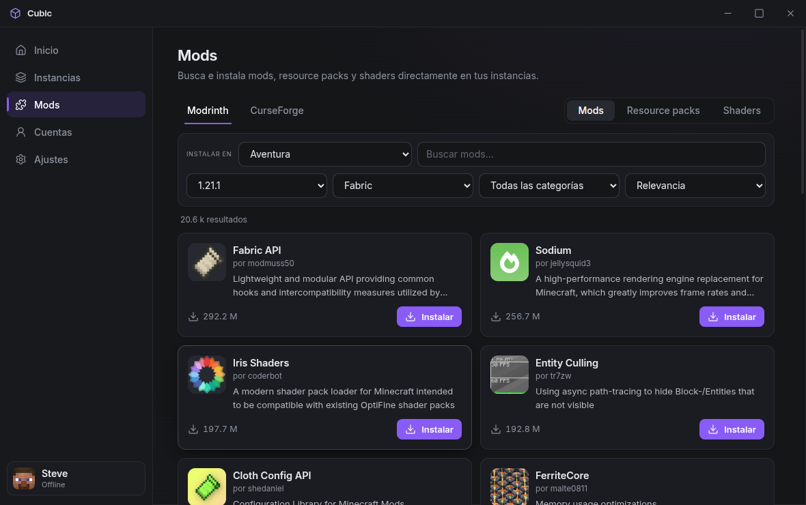

<div align="center">



# Cubic

**A simple, clean and fast Minecraft Java launcher.**

[](https://github.com/SugarSV11/Cubic/releases/latest)


[🇪🇸 Español](README.md) · 🇬🇧 English

### [⬇ Download for Linux](https://github.com/SugarSV11/Cubic/releases/latest)

<br>



</div>

> The app's interface is in Spanish.

## Features

| | |
|---|---|
| **Accounts** | Microsoft (with automatic refresh) and offline |
| **Instances** | Each with its own version, loader, RAM, icon, mods, config and worlds |
| **Loaders** | Vanilla, Fabric and Quilt |
| **Animated intro** | Animated loading screen (bundled mod). See [licenses](#bundled-mods--third-party-licenses) |
| **Horizon** | Minecraft Java 26.3 rewritten in Rust (unofficial project). See [Horizon](#horizon) |
| **Content** | Mods, resource packs and shaders from Modrinth and CurseForge, with their dependencies |
| **Java** | Downloaded automatically from Adoptium, matching the game version |
| **Disk space** | Libraries, assets and versions are shared between instances |

<div align="center">
<table>
<tr>
<td width="50%"></td>
<td width="50%"></td>
</tr>
<tr>
<td align="center"><sub>Instances</sub></td>
<td align="center"><sub>Mod browser</sub></td>
</tr>
</table>
</div>

## Requirements

- Linux x86_64 (the AppImage needs no installation).
- An internet connection to download Java, Minecraft and content.
- A Microsoft account that owns Minecraft Java to play online (offline accounts can be added afterwards).

## Installation

Download the AppImage from [Releases](https://github.com/SugarSV11/Cubic/releases/latest) and run it:

```bash
chmod +x Cubic-*.AppImage
./Cubic-*.AppImage
```

## Getting started

1. **Cuentas** (Accounts) → *Cuenta Microsoft* and sign in. You can add offline accounts afterwards.
2. **Instancias** (Instances) → *Nueva instancia*: pick a name, version, loader and RAM.
3. **Inicio** (Home) → pick the instance and press **Jugar** (Play). The first run downloads Java and the game.
4. **Mods** → search, press *Instalar* (Install) and choose the instance.

- **CurseForge** needs a free API key from <https://console.curseforge.com/>; paste it in the CurseForge tab of the mod browser or in Settings. Modrinth needs no key.
- **Shaders** require Iris, so they only install on Fabric or Quilt instances; Iris (with Sodium) is added automatically.
- **Data** lives in `~/.config/Cubic/`. Cubic never touches `~/.minecraft`. Data from the old "Sugar Launcher" is migrated on first start.
- Forge and NeoForge are not supported.

## Horizon

When an instance uses the **Horizon** loader (26.3 only), Cubic downloads the official build from [horizon-rust/horizon](https://github.com/horizon-rust/horizon), prepares textures and sounds from your own Minecraft copy (using a JDK 25 it also downloads) and shares it across all Horizon instances. Horizon is unofficial, not affiliated with Mojang or Microsoft, needs a Microsoft account that owns the game and does not support Fabric/NeoForge mods.

**Status (26 Nov 2026):** the official Horizon repository returns 404, so this feature cannot download right now and has not been tested with the real game.

## Bundled mods / third-party licenses

Cubic bundles **[Animated Mojang Logo](https://modrinth.com/mod/animated-mojang-logo)** by **BouncingElf10** (GPL-3.0-or-later), unmodified; its sha512 is checked against Modrinth at build time. Its dependencies are YetAnotherConfigLib (LGPL-3.0), Mod Menu (MIT), TimelessLib, Fabric API (Apache-2.0) and Text Placeholder API (LGPL-3.0). Authors, versions, licenses and source links are in [THIRD_PARTY_NOTICES.md](THIRD_PARTY_NOTICES.md); full texts in [LICENSES/](LICENSES/) and inside the AppImage (*Ajustes → Acerca de*). Every release also ships the corresponding source code as `Cubic-third-party-sources.tar.gz`, and you can request it by [opening an issue](https://github.com/SugarSV11/Cubic/issues).

Cubic is a separate program: it only copies these jars into the instance folder and Minecraft loads them. According to its author, the animation and jingle come from Minecraft Dungeons / MC Live and belong to Mojang Studios and Microsoft. The intro can be disabled in *Ajustes → Intro animada* or per instance.

## Building from source

With Node.js 22 and npm:

```bash
git clone https://github.com/SugarSV11/Cubic.git
cd Cubic
npm ci
npm start                                               # run in development
npm test                                                # tests
npx electron-builder --linux AppImage --publish never   # → dist/Cubic-<version>.AppImage
```

Packaging downloads and verifies the animated-intro jars (network required). `npm run fetch:sources` saves the third-party source code to `dist-sources/`. On Fedora Atomic / Bazzite, run these inside a `distrobox` container (see the Spanish README for the exact package list). `npm run dist:win` exists but has not been tested.

Every `v*` tag builds and publishes the AppImage automatically ([`.github/workflows/release.yml`](.github/workflows/release.yml)). Code layout and data flow: [docs/ARCHITECTURE.md](docs/ARCHITECTURE.md).

## Security

- `contextIsolation` and `sandbox` on, `nodeIntegration` off.
- All network requests go through the main process; the UI has a strict CSP.
- Mod descriptions are filtered through an allow-list of tags.
- Session tokens and the API key are stored in `0600` files.
- Downloads verify their hash when the source provides one.

## Project status

Stable **1.1.0** for Linux, under active development. Tested in game with Vanilla, Fabric and Quilt. Not yet done: the Windows installer is untested, Forge/NeoForge are unsupported, and Horizon and the animated intro have not been tested with the real game. See [CHANGELOG.md](CHANGELOG.md).

## License

Copyright © 2026 SugarSV11.

Cubic is free software under the **GNU General Public License v3.0 or later** ([`LICENSE`](LICENSE)). Versions 1.0.0 and 1.1.0 were released under the MIT license and remain under it; GPL-3.0 applies from the next version on. Third-party components keep their own licenses.

---

<div align="center">
<sub>Screenshots use sample data. Cubic is not affiliated with Mojang or Microsoft.</sub>
</div>
