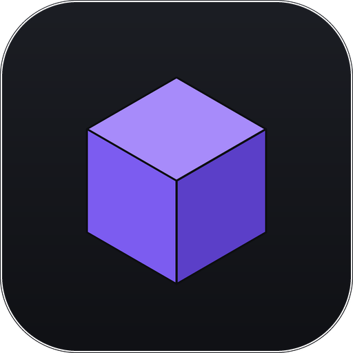
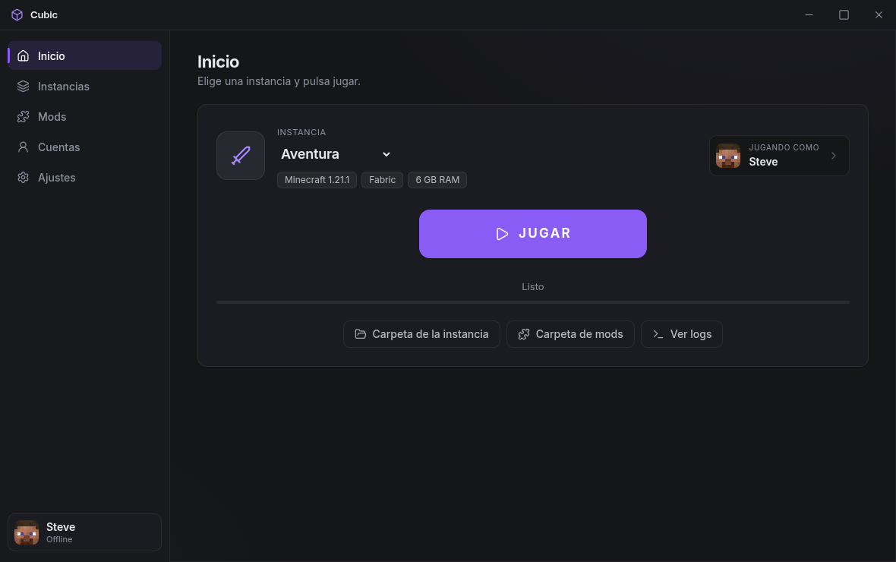
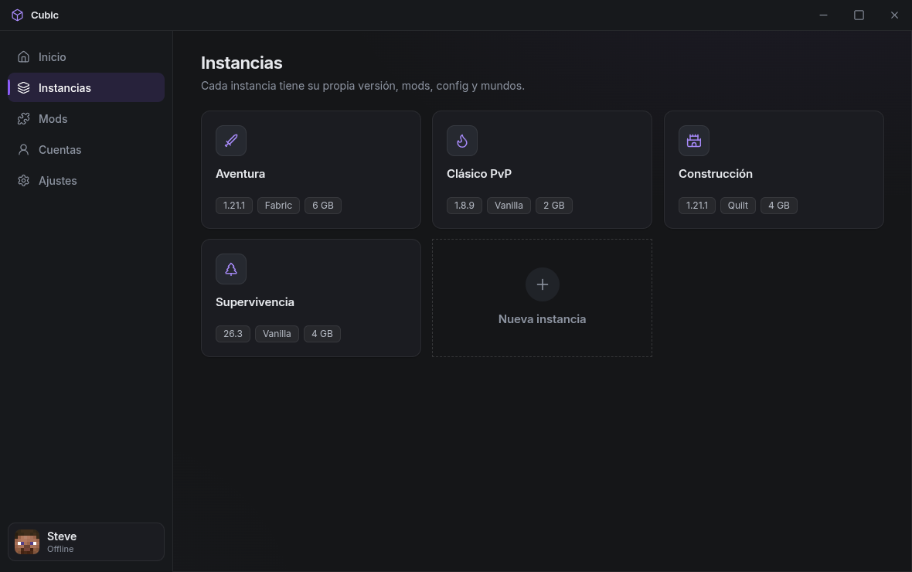
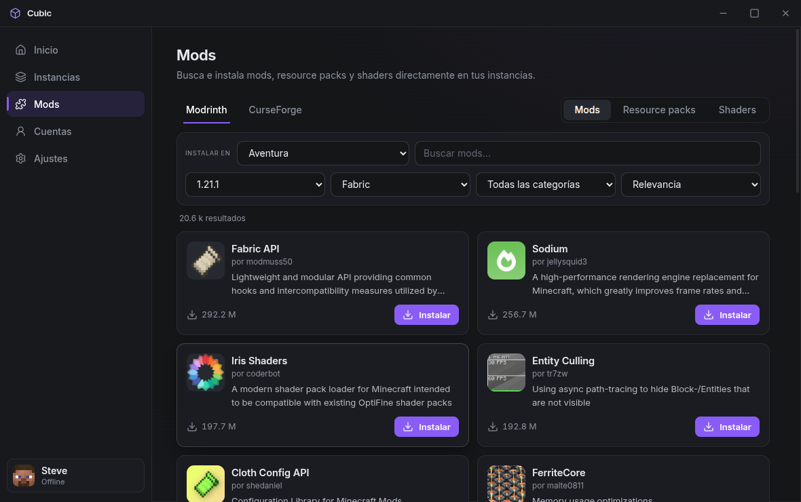

<div align="center">



# Cubic

**Un launcher de Minecraft Java simple, sobrio y rápido.**

[](https://github.com/SugarSV11/Cubic/releases/latest)
[](https://github.com/SugarSV11/Cubic/releases)


### [⬇ Descargar para Linux](https://github.com/SugarSV11/Cubic/releases/latest/download/Cubic-1.1.0.AppImage)

<br>



</div>

## Características

| | |
|---|---|
| **Cuentas** | Microsoft (con refresco automático) y offline |
| **Instancias** | Cada una con su versión, loader, RAM, icono, mods, configuración y mundos |
| **Loaders** | Vanilla, Fabric y Quilt |
| **Intro animada** | Pantalla de carga animada (mod incluido). [Detalles y licencias](#mods-incluidos--licencias-de-terceros) |
| **Horizon** | Minecraft Java 26.3 reescrito en Rust (proyecto no oficial). [Detalles](#horizon) |
| **Contenido** | Mods, resource packs y shaders desde Modrinth y CurseForge, con sus dependencias |
| **Java** | Se descarga solo desde Adoptium, según la versión del juego |
| **Espacio** | Librerías, assets y versiones compartidas entre instancias |

<div align="center">
<table>
<tr>
<td width="50%"></td>
<td width="50%"></td>
</tr>
<tr>
<td align="center"><sub>Instancias</sub></td>
<td align="center"><sub>Navegador de mods</sub></td>
</tr>
</table>
</div>

## Instalación

Descarga el AppImage desde [Releases](https://github.com/SugarSV11/Cubic/releases/latest) y ejecútalo:

```bash
chmod +x Cubic-1.1.0.AppImage
./Cubic-1.1.0.AppImage
```

## Primeros pasos

1. **Cuentas** → *Cuenta Microsoft* e inicia sesión (se necesita Minecraft Java comprado). Después puedes crear cuentas offline.
2. **Instancias** → *Nueva instancia*: elige nombre, versión, loader y RAM.
3. **Inicio** → elige la instancia y pulsa **Jugar**. La primera vez descarga Java y el juego.
4. **Mods** → busca, pulsa *Instalar* y elige la instancia.

<details>
<summary><b>Activar CurseForge (opcional)</b></summary>
<br>

CurseForge exige una API key gratuita. Modrinth no necesita ninguna.

1. Entra a <https://console.curseforge.com/> e inicia sesión.
2. Copia tu clave en *API keys* (empieza por `$2a$10$` y tiene 60 caracteres).
3. Pégala en la pestaña **CurseForge** del navegador de mods (o en **Ajustes**), pulsa **Probar key** y luego **Guardar**.

Si un autor no permite descargas desde apps externas, Cubic te avisa y ofrece abrir su página en el navegador.

</details>

<details>
<summary><b>Shaders y resource packs</b></summary>
<br>

Los shaders necesitan Iris: solo se instalan en instancias Fabric o Quilt, e Iris (con Sodium) se añade solo. Se activan en *Opciones → Gráficos → Shaders*. Los resource packs se activan en *Opciones → Paquetes de recursos*.

</details>

<details>
<summary><b>Dónde se guardan los datos</b></summary>
<br>

En Linux, en `~/.config/Cubic/`. Cubic no toca tu `~/.minecraft`.

Si venías de «Sugar Launcher», al abrir Cubic por primera vez se migran solos tus cuentas, instancias, Java y ajustes.

</details>

> Forge y NeoForge no están incluidos.

## Horizon

Al crear una instancia con el loader **Horizon** (solo 26.3), Cubic descarga la build oficial de [horizon-rust/horizon](https://github.com/horizon-rust/horizon), prepara texturas y sonidos a partir de tu Minecraft (usa un JDK 25 que también descarga solo) y la comparten todas las instancias Horizon. Cada instancia guarda aparte sus mundos y ajustes.

- Horizon es un proyecto no oficial, no está afiliado a Mojang ni a Microsoft y requiere tu propia copia de Minecraft Java 26.3.
- Hace falta una cuenta de Microsoft con el juego en Cubic. Si no encuentra tu cliente 26.3, Cubic ofrece descargarlo.
- No admite mods de Fabric ni NeoForge; Cubic tampoco instala en él shaders ni resource packs.
- **Estado (26 nov 2026):** el repositorio oficial de Horizon responde 404, así que ahora mismo no se puede descargar y esta función no se ha probado con el juego real. Cubic no usa forks ni espejos. La versión 1.1.0 incluye este soporte y la intro animada.

El logotipo de Horizon es del proyecto Horizon (ver `renderer/img/horizon-LICENSE.txt`).

## Mods incluidos / Licencias de terceros

Cubic incluye el mod **[Animated Mojang Logo](https://modrinth.com/mod/animated-mojang-logo)** de **BouncingElf10**, que cambia la pantalla de carga de Minecraft por una intro animada con su jingle.

- **Licencia:** [GPL-3.0-or-later](LICENSES/GPL-3.0.txt) (según Modrinth; su repositorio y su jar traen la GPL v3, aunque su `fabric.mod.json` aún dice `ZLIB`).
- **Sin modificaciones:** Cubic distribuye los mismos archivos que publica Modrinth; al compilar se comprueba su sha512 y la compilación falla si no coincide.
- **Código fuente** ([repositorio](https://github.com/BouncingElf10/Animated-Mojang-Logo)) de las versiones incluidas:

| Minecraft | Versión del mod | Código fuente |
|---|---|---|
| 26.3 | 2.7 | [commit `704557e`](https://github.com/BouncingElf10/Animated-Mojang-Logo/tree/704557ed29069a0f175735ae53d20bf5feff8761) |
| 26.2 | 2.7 | [commit `b53fbf2`](https://github.com/BouncingElf10/Animated-Mojang-Logo/tree/b53fbf22660c7863cd0b360721d2eca8fe9ed31b) |
| 26.1.2, 26.1.1, 26.1 | 2.7 | [commit `5c7029e`](https://github.com/BouncingElf10/Animated-Mojang-Logo/tree/5c7029e9b82586a405ea5656ce02283df0621c8a) |
| 1.21.11 | 2.7 | [commit `f52f53b`](https://github.com/BouncingElf10/Animated-Mojang-Logo/tree/f52f53b673b7312ddc8dd836cff8d25302430995) |
| 1.21.1, 1.21 | 2.7 | [commit `38af74b`](https://github.com/BouncingElf10/Animated-Mojang-Logo/tree/38af74bb493196c3d08dd2b9accca1a9c5f78ba2) |

- **Oferta de código fuente:** si pides el código fuente correspondiente a cualquiera de estos archivos [abriendo un issue](https://github.com/SugarSV11/Cubic/issues), te lo entrego sin coste (más allá del de enviarlo). La oferta vale durante al menos tres años desde la última distribución de la versión de Cubic que los contiene.
- **Dependencias:** el mod necesita YetAnotherConfigLib (LGPL-3.0), Mod Menu (MIT), TimelessLib, Fabric API (Apache-2.0) y Text Placeholder API (LGPL-3.0). Autores, versiones, licencias y código fuente de cada una, y las builds de otras versiones que se descargan de Modrinth solo si se usan, están en [THIRD_PARTY_NOTICES.md](THIRD_PARTY_NOTICES.md). Los textos están en [LICENSES/](LICENSES/) y también dentro del AppImage (**Ajustes → Acerca de → Abrir carpeta de licencias**).
- **Programa independiente:** Cubic es un programa aparte. No enlaza ni mezcla código de estos mods; solo copia sus jars en la carpeta de la instancia, y es Minecraft quien los carga. La licencia de cada mod se aplica a ese mod, no al resto de Cubic.
- **Material de Mojang:** según su autor, la animación y el jingle son los de Minecraft Dungeons / MC Live. Pertenecen a Mojang Studios y Microsoft; la licencia del mod no da derechos sobre ellos.
- **Cómo desactivarlo:** *Ajustes → Intro animada*, o el interruptor de cada instancia. En instancias Vanilla, desactivarla vuelve a Vanilla puro.
- Ni Cubic ni estos mods están afiliados, patrocinados ni aprobados por Mojang ni por Microsoft.

## Intro animada: cómo funciona

- Activada por defecto en instancias Vanilla y Fabric (también en las que ya tenías). No se aplica a Quilt ni a Horizon.
- En Vanilla se juega con Fabric Loader mientras esté activada. Si esa instancia tiene otros mods en su carpeta, no se aplica.
- Incluida dentro de la app para Minecraft 26.3, 26.2, 26.1.2, 26.1.1, 26.1, 1.21.11, 1.21.1, 1.21. Para 17 versiones más se descarga una sola vez. Las versiones sin build compatible se quedan como están (por ejemplo 1.19.3, 1.19.4, 1.21.2 y 1.21.9).
- Si borras sus archivos desde la pestaña Mods, Cubic no los vuelve a poner en esa instancia.

## Desarrollo

<details>
<summary><b>Compilar desde el código (Bazzite / Fedora Atomic)</b></summary>
<br>

El sistema es inmutable, así que todo se hace dentro de un contenedor.

```bash
git clone https://github.com/SugarSV11/Cubic.git
cd Cubic

# Crear el contenedor (una sola vez)
distrobox create --name sugarlauncher --image registry.fedoraproject.org/fedora-toolbox:43 --yes

# Node y las librerías que necesita Electron (dentro del contenedor)
distrobox enter sugarlauncher -- sudo dnf install -y nodejs npm nss nspr atk at-spi2-atk at-spi2-core \
  gtk3 libXcomposite libXdamage libXrandr libxkbcommon alsa-lib mesa-libgbm libdrm cups-libs xdg-utils

# Dependencias, ejecutar y empaquetar
distrobox enter sugarlauncher -- npm install
distrobox enter sugarlauncher -- npm start
distrobox enter sugarlauncher -- npm test
distrobox enter sugarlauncher -- npm run dist    # → dist/Cubic-1.1.0.AppImage
```

Al empaquetar se descargan y verifican los jars de la intro animada (hace falta conexión); no están en el repositorio.

- `npm run fetch:sources` guarda en `dist-sources/` el código fuente de lo incluido, para **adjuntarlo a cada release**.
- `node scripts/update-animated-logo.js` actualiza las versiones (`animated-logo.lock.json` y `THIRD_PARTY_NOTICES.md`).

Existe `npm run dist:win` para generar un instalador de Windows, pero todavía no se ha probado.

</details>

<details>
<summary><b>Estructura del proyecto</b></summary>
<br>

```
main.js            punto de entrada (ventana sin marco, seguridad)
preload.js         puente seguro entre la interfaz y el sistema
main/              cuentas, instancias, lanzador, Java, Horizon, Modrinth, CurseForge, instalador
renderer/          interfaz en HTML, CSS y JavaScript puro
  js/screens/      una pantalla por archivo
  js/lib/          utilidades (DOM, iconos, avisos, modales, Markdown seguro)
  fonts/           Inter (licencia OFL) incluida localmente
build/icon.png     icono
scripts/           descarga y actualización de la intro animada
LICENSES/          textos de las licencias de terceros
docs/              capturas
```

</details>

<details>
<summary><b>Seguridad</b></summary>
<br>

- `contextIsolation` y `sandbox` activados, `nodeIntegration` desactivado.
- Las peticiones de red las hace el proceso principal; la interfaz tiene una CSP estricta.
- Las descripciones de mods pasan por un filtro de etiquetas permitidas.
- Los tokens de sesión y la API key se guardan en archivos con permisos `0600`.
- Las descargas verifican el hash SHA-1 cuando el sitio lo proporciona.

</details>

---

<div align="center">
<sub>Las capturas usan datos de ejemplo. Cubic no está afiliado a Mojang ni a Microsoft.</sub>
</div>
